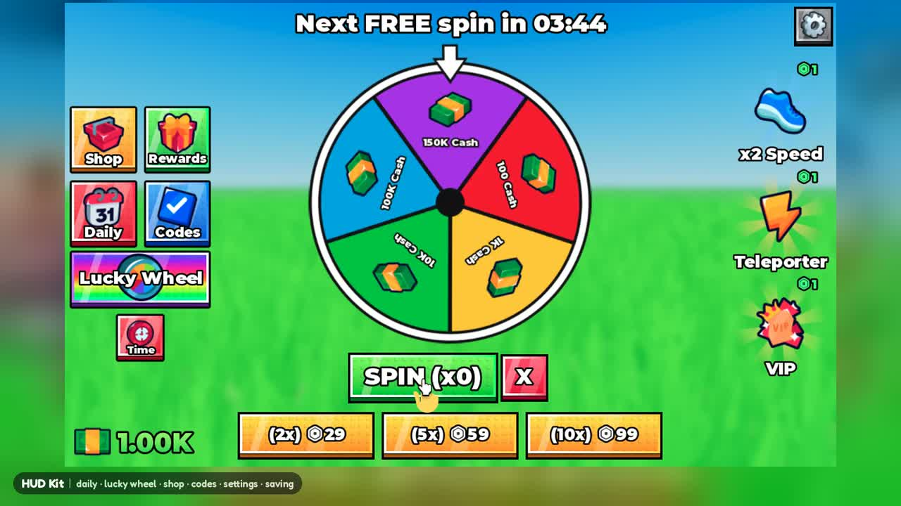
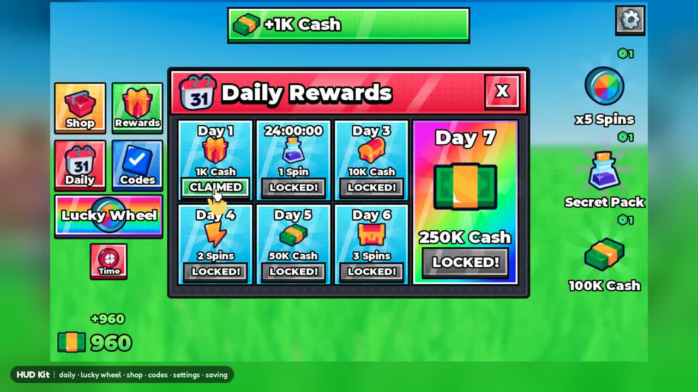
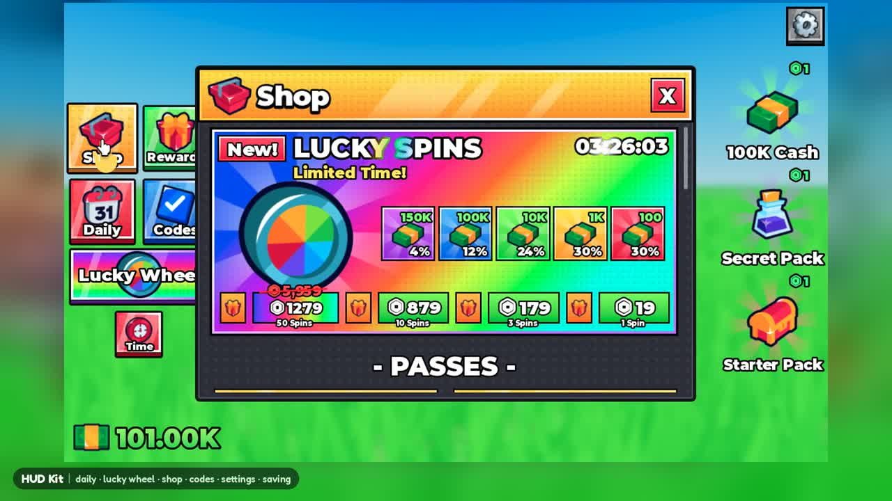
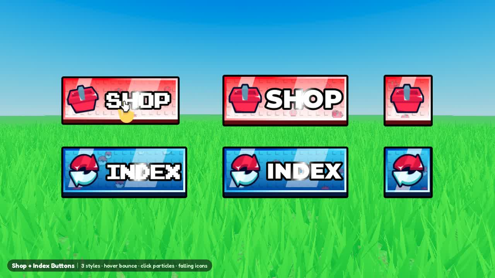
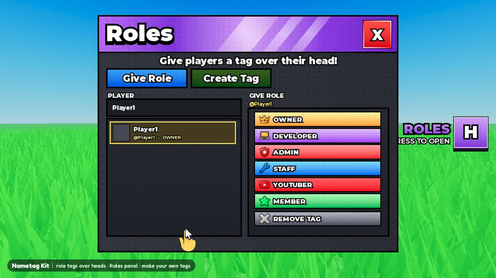
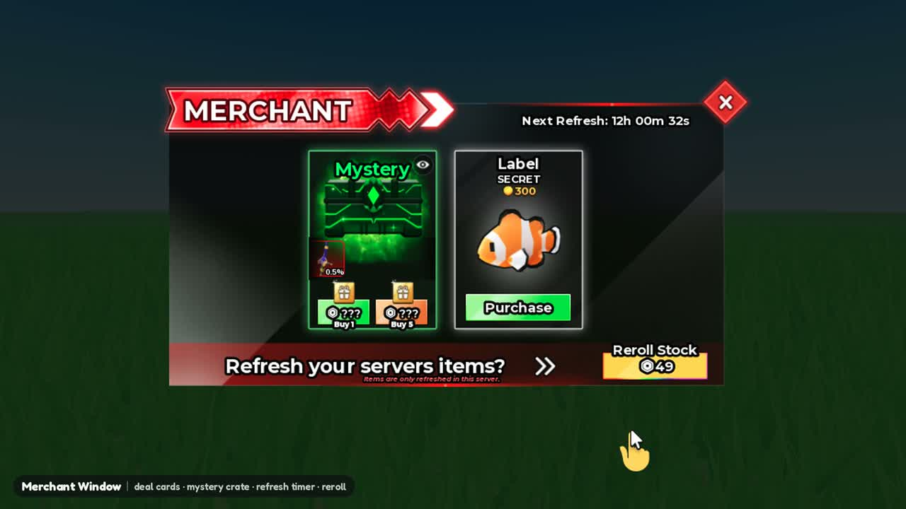

# Momentum's UI Pack v2 (free)

Front-page-quality Roblox UI you can drop straight into your game, plus a Claude Code skill that builds the rest of your UI in the same style.

Made by **@momentumcash**. Free to use in your games.

▶ **[Watch the trailer](pics/trailer.mp4)**



## What you get

| Kit | What's in it |
|---|---|
| **HUD Kit** | Cash counter, left menu (Shop, Rewards, Daily, Codes, Lucky Wheel, Time), right offers, and working Daily Rewards, Lucky Wheel, Shop, Rewards, Codes, Gift and Settings windows. Saving, codes and gifting run on the server. |
| **Shop + Index Buttons** | 3 button styles with hover bounce, click particles, falling icons and an animated outline |
| **Nametag Kit** | Role tags over every player's head and a Roles panel (press H) to give roles and make your own tags |
| **Merchant Window** | Deal cards, mystery crate, refresh timer, reroll stock. No scripts, ready for you to wire up |
| **The skill** (`momentum-ui-pack/`) | A Claude Code skill that starts every new screen from these kits and checks it on phone and PC before showing you |

|  |  |
|---|---|
|  |  |



## Set it up with your AI (easiest)

Connect Roblox Studio to Claude Code first: in Studio, **Assistant** > **...** > **Manage MCP Servers** > **Quick connect** > **Claude Code**. Open your game in Studio, then paste this into Claude Code:

```
Set up Momentum's UI Pack v2 for me from https://github.com/momentumcash/momentums-ui-pack-v2
Download it, copy the momentum-ui-pack folder into my ~/.claude/skills folder,
then put the HUD Kit in StarterGui in my open Roblox Studio game, press Play and check every window opens.
After that, use /momentum-ui-pack for any new UI I ask for.
```

## Or set it up yourself

1. Download this repo: green **Code** button > **Download ZIP**, then unzip it.
2. Open your game in Roblox Studio.
3. Right-click **StarterGui** > **Insert from File** and pick any `.rbxm` in `momentum-ui-pack/kits/`.
   - **HUD Kit**: installs itself on Play. Put your own product and pass ids in `HUDConfig` (0 = not set).
   - **Nametag Kit**: follow the steps in its `READ ME` script. Turn on Game Settings > Security > Studio Access to API Services.
4. Press **Play**.

Want the skill too? Copy the `momentum-ui-pack` folder into `~/.claude/skills/` (Windows: `C:\Users\<you>\.claude\skills\`) and restart Claude Code.

## Licence

Free to use in your games. Never sell this pack or put it behind a paywall. Details and credits: `momentum-ui-pack/LICENSE.md` and `momentum-ui-pack/CREDITS.md`.
